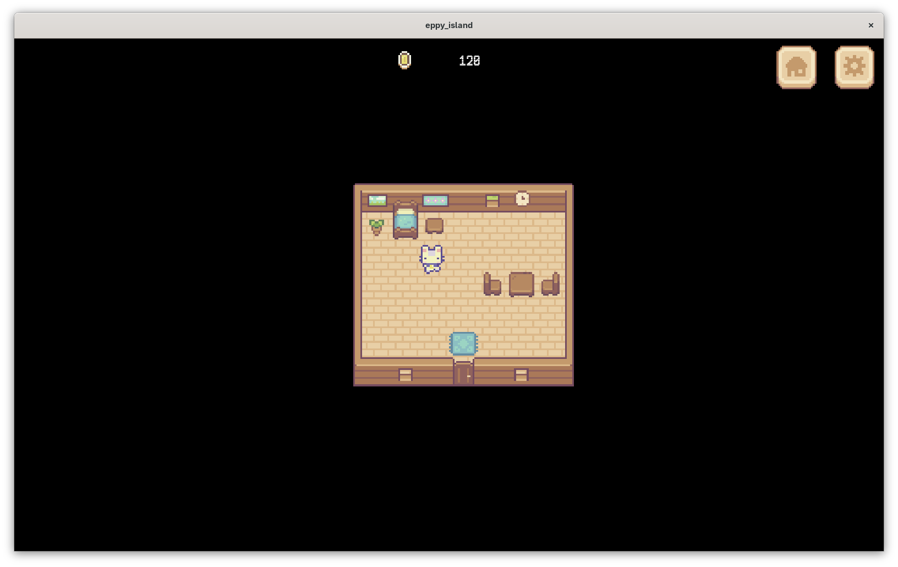
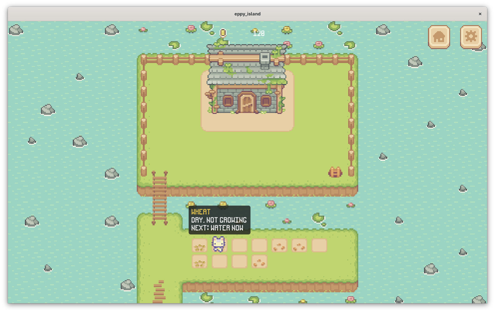
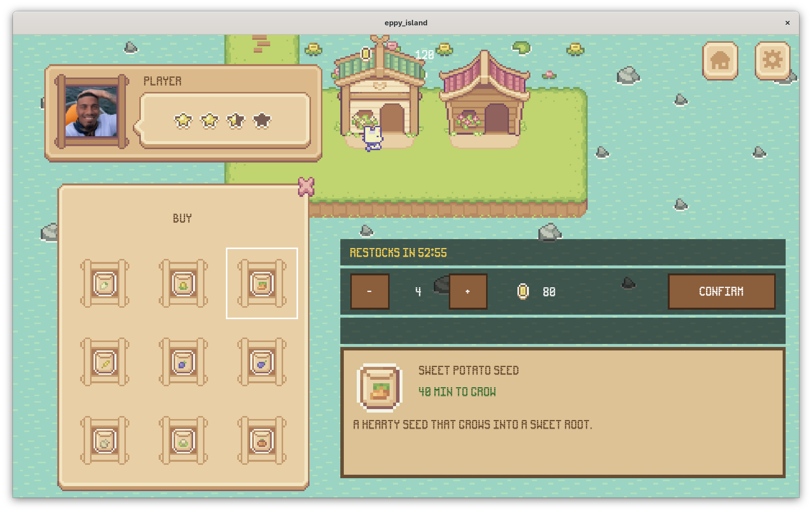
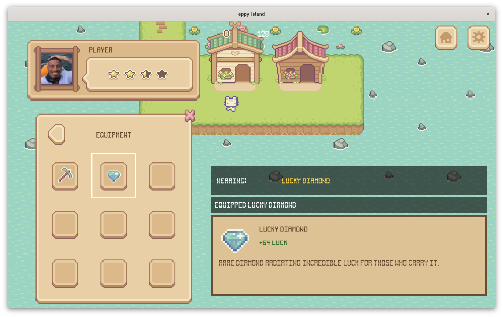
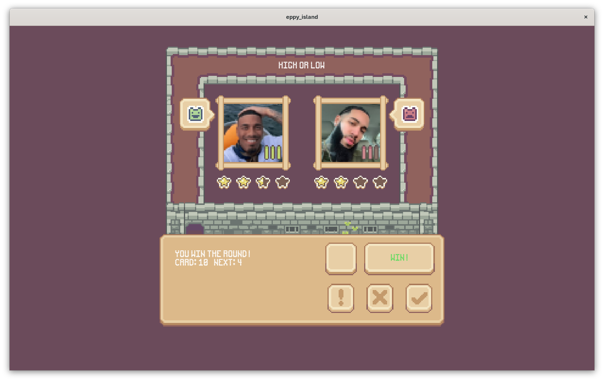
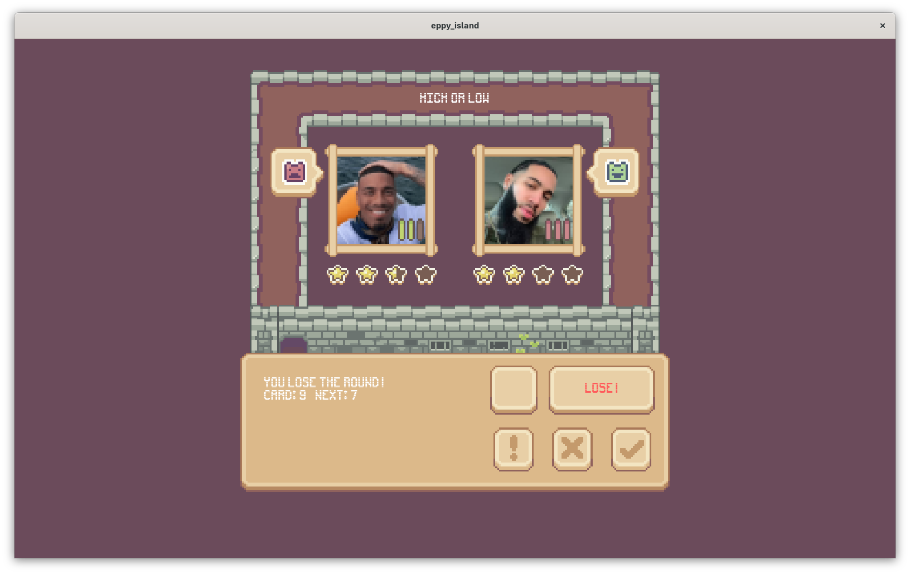
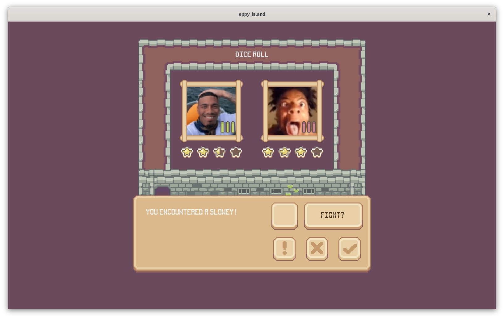

# Eppy Island

> silly game

- **Live demo:** https://aonnoes.github.io/eppy-island/
- **Demo video:** [Video](docs/05-demo-video.md)
- **Course:** Applications Development and Emerging Technologies (6ADET), Holy Angel University
- **Author:** Aaron Noel

---

## Screenshots

| | |
|:---:|:---:|
| [](docs/assets/Screenshots/Screenshot-1.png) | [](docs/assets/Screenshots/Screenshot-2.png) |
| [](docs/assets/Screenshots/Screenshot-3.png) | [](docs/assets/Screenshots/Screenshot-4.png) |
| [](docs/assets/Screenshots/Screenshot-5.png) | [](docs/assets/Screenshots/Screenshot-6.png) |
| [](docs/assets/Screenshots/Screenshot-7.png) | |

## Description

A silly and unserious dungeon-farming game where players venture underground to gamble against monsters, collect seeds, and bring their winnings back home. Players can buy seeds, equipment, and useful items, sell things they no longer need, and grow crops to build a stable source of income for their next ridiculous dungeon run.

- Farm Seeds — Plant seeds and grow crops to create a steady source of income.
- Enter the Dungeon — Venture underground and gamble against monsters for rewards and valuable items.
- Buy Supplies — Spend your money on seeds, equipment, and useful items from the shop.
- Sell Your Extras — Sell items you no longer need to earn extra money and keep your resources flowing.
- Build Your Income — Use your farm profits to fund more dungeon runs and keep the cycle going.

## How to play

Eppy Island is a loop: **farm, sell, shop, gamble, repeat.** You grow crops at home for slow, steady coins, then spend those coins on seeds and gear and take your luck underground to win more. Nothing is timed against you, so play at whatever pace you like.

### Controls

| Key | What it does |
| --- | --- |
| `W` `A` `S` `D` | Walk |
| `E` or `Space` | Action key: till, plant, water or harvest the plot in front of you |
| `Q` | Open the inventory |
| `Esc` | Close the screen on top |

In the dungeon you only use the on-screen **Yes**, **No** and **Consume** buttons (or tap/click them). `Space` also moves past a result.

### Your first ten minutes

1. Open the inventory and check your coins, luck stars and items.
2. Visit the shop and buy a few cheap seeds (Radish, Lettuce and Wheat cost 10 coins each).
3. Pick the seed you want on the **Seeds** screen, walk up to a plot and press `E` to till, plant and water it.
4. Come back when the crop looks ripe and harvest it. Sell the crops at the shop.
5. Spend the coins on more seeds or on gear that adds luck, then try the dungeon.

## Game mechanics

### Farming

- Pressing the action key on a plot does whatever it needs next: **till, then plant, then water, then wait, then harvest.** The plot's label tells you the next step and how long is left.
- A crop **only grows while it is watered.** Water lasts about 20 minutes. When it runs out the plant stops growing until you water it again. You can top it up once less than half is left, so check back on slow crops.
- Growth follows the real clock, so a watered crop keeps growing while the game is closed, until its water runs out.
- Some crops are **one-time** (the plot stays tilled after harvest). Others **regrow**: after a harvest they go back to being watered and ripen again on a shorter timer, so one seed pays out many times.
- Your **luck** gives a percentage chance of **one extra crop** when you harvest. Luck 25 means about a one in four chance of a bonus.
- Seeds are picked on the **Seeds** screen. If the chosen seed runs out, the first seed in your inventory is used.

### Items, inventory and equipment

- The inventory holds up to **9 different items**, up to **99** of each. A full inventory means you can't buy or harvest something new until you sell or use something.
- **Equipment** is worn from the **Equipment** screen. You wear one at a time, and it adds to your luck while worn. Tap it again to take it off.
- **Consumables** also live on the **Equipment** screen, not the inventory. Tap one to pick it as your dungeon item. The picked consumable is highlighted, and the Consume button in the dungeon uses it.
- Everything else (seeds, crops) is on the **Items** screen.

### The shop

- The shop sells **9 items at a time** and restocks **every hour**, on the hour of your clock. Everyone gets the same stock in the same hour, and closing the game doesn't change it.
- You can sell anything you own that has a sell price. Seeds sell for about half of what they cost.
- The **Buy** and **Sell** screens have a quantity counter. Pick an item, set the amount, then confirm.

### Luck

- Luck is a number from **1 to 100**, shown only as **four stars**. Each star is worth 25 luck, and a half star appears at 12.5.
- It comes from your base luck plus the equipment you are wearing. Luck helps in two places: bonus crops when you harvest, and your odds in dungeon fights.
- The stars in the dungeon show your luck for **that fight**, including any consumable you have used.

### The dungeon

Stand on the dungeon entrance and press `Space`. You meet a random monster, and the screen shows its name, its difficulty stars and a lives bar for each side.

1. **Intro.** The prompt asks **FIGHT?**
   - **Yes** starts the fight.
   - **No** leaves right away. Nothing is won or lost.
   - **Consume** uses your picked consumable first (for example a Life Potion doubles your luck for this fight). You stay on the intro screen and can then answer Yes or No.
2. **Rounds.** You and the monster each start with the same number of lives (3 by default). Win a round and the monster loses a life. Lose a round and you lose one. A tie costs nobody.
3. **The result.** The fight ends when either side runs out of lives. Beat the monster and you get its **coin reward**. Lose and you pay its **coin penalty**, but never more coins than you have.
4. After each round the result stays on screen until **you** press **Yes** (or `Space`) to continue, so you can read it at your own pace. The reaction faces show for a moment on their own timer.

### Minigames

Every monster plays one of three games. The context box explains the situation, and the small **action rectangle** above the Yes and No buttons shows a one-word question. The colour tells you what is happening: dark brown for a question, green for a win, red for a loss.

- **Rock Paper Scissors.** The game offers you one move, such as **ROCK?**. Rock beats scissors, scissors beat paper, paper beats rock.
- **High or Low.** You are shown a card from 1 to 13, and the game offers **HIGH?** or **LOW?** for whether the next card will be higher or lower. The same card is a tie.
- **Dice Roll.** You and the monster each roll a six-sided die, and the higher roll wins. There is only one action, so you just press **Yes** to roll.

### How Yes and No work during a round

You never pick from a list. Each round the game **offers you one action**:

- **Yes** plays the action you were offered.
- **No** makes the game pick an action **at random** from all of them (it can be the same one it offered).

**Luck decides what you are offered.** With luck out of 100, the offered action is the **winning** one that many percent of the time, and a random one otherwise. So the higher your luck, the safer it is to just say **Yes**. At very low luck, Yes and No are close to a coin flip.

Dice has nothing to offer, so luck works differently there: a lost roll has a luck-sized chance of being quietly re-rolled, and the re-roll is kept.

## Strategies

- **Start with fast crops.** Radish and Lettuce are cheap, grow in 15 to 20 minutes and sell for noticeably more than the seed cost. Check each crop's label before you commit. Wheat sells for slightly *less* than its seed costs, so it isn't a way to make money.
- **Plant a regrowing crop for the long game.** Peas, cucumbers, tomatoes, eggplants and the berries cost more up front, but one seed gives repeated harvests. The rare seeds (Pineapple, Starfruit, Blue Starfruit) take the longest and sell for the most.
- **Water before you leave.** Water only lasts about 20 minutes. If you will be away a long time, slow crops will stall until you come back to water them.
- **Luck is worth buying.** Equipment adds luck, and luck helps both your harvest and your fights. Put on your best equipment before you enter the dungeon, and check the stars.
- **Save potions for the fights that matter.** A Life Potion doubles your luck for one fight, which matters most against monsters with big penalties. Using two stacks to four times your luck.
- **Know when to say No.** If you don't like a fight, answer No on the intro and walk away for free.
- **With high luck, say Yes.** The offered action is usually the winning one. With luck at 1, an offer is no better than a random pick.
- **Penalties can't take what you don't have.** A loss never takes more coins than you hold, so keep your coins low before a risky run, or spend them on seeds and gear first.
- **Check the shop each hour.** Stock changes every hour. If the seed or gear you want isn't there, come back after the restock.

## Intended gameplay

Eppy Island is meant to feel silly and low-pressure. A normal session goes like this:

1. **Start at home.** Check your crops, water what is dry, harvest what is ripe.
2. **Cash out.** Sell crops at the shop, then spend on seeds and anything that adds luck.
3. **Replant.** Put new seeds in the ground so the farm keeps earning while you are away.
4. **Take a gamble.** Walk to the dungeon with your best equipment and a potion or two, and fight monsters for coins.
5. **Return and repeat.** Use the winnings to grow a bigger farm, and use the bigger farm to afford better runs.

The farm is your **safe income** and the dungeon is your **risky income**. Farming pays slowly and reliably. Dungeon fights can pay a lot quickly, or cost you. The best players mix the two: the farm funds the gambling, and the gambling buys the luck and seeds that make the farm better.

## Built with Flame

| | |
| --- | --- |
| Framework | Flutter (Dart) + Flame |
| State | Flame component state and Flutter `ChangeNotifier` / `ValueNotifier`; no external state-management package |
| Storage | A local JSON save file (`eppy_island_save.json`) in the user's documents folder; game data is loaded from `assets/data` and Tiled maps |
| Other packages | `flame_tiled` — loads and renders Tiled `.tmx` maps and their object layers; `path_provider` — finds the folder for the save file |

Running it yourself

### Requirements

- **Flutter SDK**, which includes the Dart SDK. Follow the [official Flutter installation guide](https://docs.flutter.dev/install), then run `flutter doctor` to check that your setup is ready.
- **A supported run target:** Chrome for the web version, or a configured Linux, Windows or macOS desktop environment. Desktop targets may require additional tools for your operating system; see the [Flutter desktop setup guide](https://docs.flutter.dev/platform-integration/desktop).

This project uses **Flame** as its game engine, along with `flame_tiled` for Tiled maps. Both are already listed in `pubspec.yaml`, so you do not need to install Flame separately. Running `flutter pub get` downloads Flame and the other project dependencies.

### Setup and run

Clone the repository or download and extract its ZIP file, then open a terminal in the project folder (the one containing `pubspec.yaml`). The repository does not include the generated web and desktop runner folders, so create them once:

```bash
flutter create --platforms=web,linux,windows,macos .
flutter pub get
```

Choose **one** of the following commands to run the game:

```bash
flutter run -d chrome   # Run as a web app in Chrome
flutter run -d linux    # Run as a Linux desktop app
flutter run -d windows  # Run as a Windows desktop app
flutter run -d macos    # Run as a macOS desktop app
```

In these commands, `-d` means **device**: the word after it tells Flutter which target to launch the game on. Use only the command for your target. Chrome must be installed for the web version, and native desktop builds require the corresponding operating system and its Flutter development tools. You can run `flutter devices` to see the targets Flutter detects on your machine.

Progress is saved to `eppy_island_save.json` when running on a supported native device. The live web demo cannot write that local save file, so it starts fresh each visit.

### Environment variables

The game does not use any environment variables, API keys, or secrets.

## Privacy and secret

- What personal data this app stores, if any, and where it goes.
  - The only data saved is game progress (player name, coins, luck, inventory, equipped item, current map, position, etc.) in a local save file on your own device. Nothing is sent anywhere, and the game has no network code.
- Where the secrets live
  - The game has no secrets. Local machine files such as `android/local.properties` stay on my computer and are not committed.
- Confirm that all sample data, screenshots and the video contain
  - Only game content and the default player name, with no real personal information.

See [Security and privacy](docs/06-security-and-privacy.md) for details.

## Project documentation

| Document | |
| --- | --- |
| [Proposal](docs/01-proposal.md) | the problem, the users, the scope |
| [Mockup and wireframes](docs/02-mockup.md) | what it looks like, and the screen flow |
| [Design system](docs/03-design-system.md) | colors, type, spacing, components |
| [Weekly reports](docs/04-weekly-reports.md) | what happened each week |
| [Demo video](docs/05-demo-video.md) | the recording and what it shows |
| [Security and privacy](docs/06-security-and-privacy.md) | what the game stores and the risks |
| [Security checklist](docs/07-security-checklist.md) | the checklist, filled in |
| [AI usage](docs/AI-USAGE.md) | where AI tools were used |

## Status and what is next

The game is early, but the full loop can be played from start to finish: farm, sell, shop, gamble in the dungeon, repeat.

### Working now

- Walking between maps through warp blocks
- Farming: till, plant, water and harvest, with growth that follows the real clock and crops that regrow
- Inventory, equipment (worn for luck), consumables (used in the dungeon) and a Seeds screen
- The shop, with a stock that restocks every hour, and selling
- The dungeon: random monsters, lives, and coin rewards and penalties
- Three dungeon games: Rock Paper Scissors, High or Low and Dice Roll, with luck shown as stars
- Saving and loading to a local file (not available in the web demo)
- A pause screen (`Esc`) and a walking animation for the player
- An interface built from Tiled maps, so screens can be changed without touching code

### Next

**The bare minimum for a complete game**

- A title screen with new game, continue and quit
- A settings screen (volume, controls)
- A short in-game tutorial, so a new player doesn't need this README
- A clear goal or ending (for example, save up for something big), so there is a reason to keep playing
- Enchanced ouch and gamepad controls, so it plays on a phone as well as a keyboard
- A way to start over with a fresh save from the game without touching files with a file manager
- A bug-fixing and balancing pass on prices, grow times, rewards, penalties and luck

**Audio**

- Background music for the farm, the shop and the dungeon
- Sound effects for tilling, planting, watering, harvesting, buying, selling, button presses, and winning or losing a round (the Sprout Lands pack came with sound effects)
- A mute button and separate music and effects volume

**Animations**

- Crops swaying or popping when they finish growing
- Tilling, watering and harvesting animations for the player
- Smoother dungeon moments: a dice roll, a card flip, a rock-paper-scissors reveal, and monster reactions
- Button press feedback and small effects for coins and luck stars changing
- More fades and transitions between the farm, the shop and the dungeon

**More content**

- More monsters, with their own art, difficulty and rewards
- More dungeon games, and more than one dungeon level or depth
- More equipment and consumables, and dungeon rewards that include items as well as coins
- More crops, decorations and farm plots, and room to expand the farm
- More shops or shop types, and special or rare stock
- Quests or daily goals to give each session a direction

## Credits

- **Sprout Lands** — a simple cute 16-bit pixel art farming asset pack with animals and farming, along with farming GUI asset pack with icons, buttons, character expresions, and many other tiles in pastel colors. Also came with sound effects.
  - Source: [Asset Pack](https://cupnooble.itch.io/sprout-lands-asset-pack) and [UI Expansion](https://cupnooble.itch.io/sprout-lands-ui-pack)
  - Artist: [Cup Nooble](https://itch.io/profile/cupnooble)

- **Spellthorn** — a YouTube channel that served as a major guide and reference throughout the development of Eppy's Island. Their videos were extremely helpful in learning game development concepts, workflows, and techniques, and I am genuinely very grateful for the guidance and inspiration they provided.
  - Creator: [Spellthorn](https://www.youtube.com/@Spellthorn)

- Packages: see `pubspec.yaml`

## AI use

I used ChatGPT and Claude throughout development to organize my ideas (including documentation and this disclosure), explain unfamiliar Dart/Flutter/Flame code, help debug and refactor existing code, and implement features such as farming and dungeon encounters. I reviewed and adapted their output, but AI contributed to both the code and writing; the fuller account, including mistakes and my own contributions, is in [AI usage](docs/AI-USAGE.md).

## License

The source code of this project is licensed under the MIT License.
See the [LICENSE](LICENSE) file for details.

Third-party assets, including artwork, music, sound effects, fonts, and
other resources, are subject to their respective licenses and are not
necessarily covered by the MIT License.
