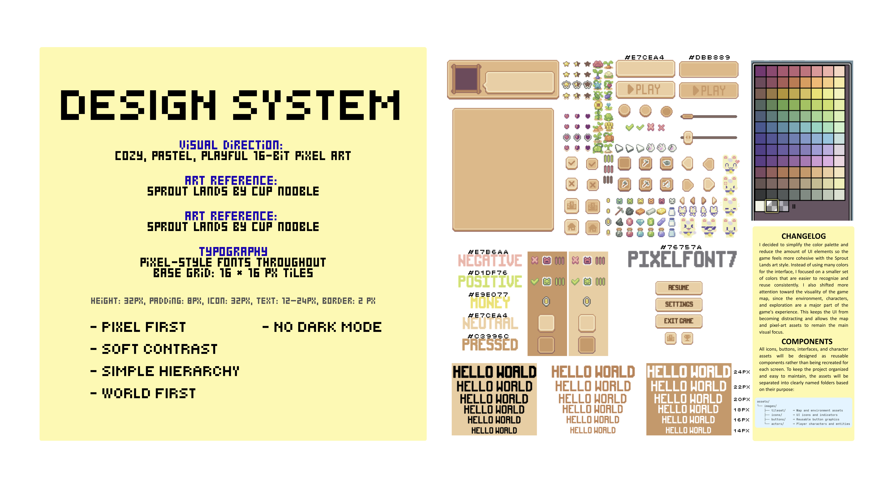

# Design system



**Visual direction:** cozy, pastel, playful 16-bit pixel art.
**Art reference:** [Sprout Lands](https://cupnooble.itch.io/sprout-lands-asset-pack) by Cup Nooble.

**Principles**

- **Pixel first:** everything is drawn in pixel art, including the interface.
- **Soft contrast:** warm, muted colors instead of harsh black and white.
- **Simple hierarchy:** few kinds of elements, so it is obvious what matters on a screen.
- **World first:** the map, characters, and exploration are the focus, and the UI stays quiet.
- **No dark mode:** the game has a single, fixed look.

## Palette

The interface uses a small set of warm tan and brown tones taken from the Sprout Lands palette. The full pack palette is shown in the image above, and only a few colors are used for the UI.

| Role | Hex | Used for |
| --- | --- | --- |
| Panel and button (light) | `#E7CEA4` | Panels, buttons, neutral text |
| Panel and button (darker) | `#DBB889` | Secondary and disabled buttons |
| Pressed | `#C3996C` | Pressed buttons and slots |
| Positive | `#D1DF76` | Gains, confirmations |
| Negative | `#E7B6AA` | Losses, errors, close and cancel |
| Money | `#E9E077` | Coin counter and prices |
| Neutral text | `#E7CEA4` | Regular labels |
| Pixel font gray | `#76757A` | Text on light panels |

Colors set in code for elements that have no art yet or need a highlight:

| Role | Hex | Used for |
| --- | --- | --- |
| Equipped highlight | `#FFD54F` | Border on the slot holding the equipped item |
| Selected highlight | `#FFFFFF` | Inner border on the selected slot |
| Fallback button | `#8B5E3C` | Text button when its sprites are missing |
| Fallback button (pressed) | `#63452C` | Pressed text button |
| Fallback button (disabled) | `#8A8A8A` | Disabled text button |
| Fallback button border | `#3E2A1A` | Text button border |
| Modal backdrop | `#000000` at 60% | Dims the game behind a modal screen |

## Type scale

The game uses pixel-style fonts throughout. The reference font is Pixel Font 7, from the Sprout Lands UI pack (`pixelFont-7-8x14-sproutLands.ttf`).

| Size | Typical use |
| --- | --- |
| 24px | Largest headings |
| 22px | Screen titles |
| 20px | Section titles |
| 18px | Buttons and labels |
| 16px | Body text |
| 14px | Small captions |

Text in components ranges from 12px to 24px in the design. In the game, label size is set per object in `UI.tmx` (the `size` property, default 10) at the 480 × 283 game resolution, and item counts use 8.

## Spacing

| Token | Value |
| --- | --- |
| Base grid | 16 × 16 px tiles |
| Component height | 32px |
| Padding | 8px |
| Icon size | 32px |
| Border | 2px |
| Game view | 480 × 283 px (30 tiles wide, matching `UI.tmx`) |

## Components

The UI is built from the Tiled map `assets/tiles/UI.tmx` by `UiManager`, so a screen is a layer in the map and its parts are Tiled objects. Each object's Tiled class picks the component. Sprites come from `assets/images/hud/`, and a missing sprite is skipped instead of crashing.

| Component | Tiled class | What it is | Where it lives | Main parameters |
| --- | --- | --- | --- | --- |
| UiManager | n/a | Builds every screen from `UI.tmx`, opens and closes screens, handles hotkeys and Escape | `lib/ui/ui_manager.dart` | `delegate` |
| UiImage | `Panel`, `Image` | Sprite that can be fixed, follow a bound sprite name, or dim below a level | `lib/ui/ui_elements.dart` | `spriteName`, `spriteBinding`, `levelBinding`, `minLevel` |
| UiLabel | `Label` | Text that is fixed or follows a bound value, with optional wrapping | `lib/ui/ui_elements.dart` | `text`, `style`, `align`, `binding`, `wrap` |
| UiBox | `Box` | Flat colored rectangle for card backgrounds | `lib/ui/ui_elements.dart` | `color` |
| Sprite button | `Button` | Button with `_unpressed` and `_pressed` sprites | Flame `SpriteButtonComponent`, built in `ui_manager.dart` | `sprite`, `action`, `target`, `enabled` |
| UiTextButton | `Button` (no art) | Flat colored button with text, used until the sprites exist | `lib/ui/ui_elements.dart` | `label`, `onPressed` |
| UiSlot | `Slot`, `Grid` | Tappable square showing an item, a quantity, and equipped and selected borders | `lib/ui/ui_elements.dart` | `kind`, `index`, `source`, `selection`, `itemScale`, `onTap` |
| UiBackdrop | `modal` layer | Dims the game and blocks taps behind a modal screen | `lib/ui/ui_elements.dart` | `size` |
| UiController | n/a | Game rules behind the UI: slot taps, quantity, buy, sell, equip, luck stars | `lib/ui/ui_controller.dart` | `profile`, `shop` |
| Slot sources | n/a | Where a grid gets its items: the player's inventory or the shop's stock | `lib/ui/slot_sources.dart` | `InventorySlotSource(profile, accepts)`, `ShopSlotSource(shop)` |
| ScreenFade | n/a | Full-screen black fade overlay used for map changes | `lib/components/screen_fade.dart` | `fadeTo(target, duration)` |
| Player | n/a | The Teemo character with eight-direction walking animations | `lib/components/player.dart` | `character` |
| WarpBlock | `Warp` | Invisible trigger that loads another map | `lib/components/blocks.dart` | `targetLevel`, `targetSpawn` |
| CollisionBlock | other objects on `Collisions` | Solid rectangle the player cannot walk through | `lib/components/blocks.dart` | `position`, `size` |

Screens each UI component appears on:

| Component | Used on |
| --- | --- |
| UiImage, UiLabel | HUD, pause menu, inventory, equipment, buy, sell |
| Sprite button, UiTextButton | HUD, pause menu, buy and sell screens (quantity and confirm) |
| UiSlot | Inventory, equipment, buy, and sell screens |
| UiBackdrop | Modal screens such as the pause menu |
| ScreenFade, WarpBlock | Every map change |
| Player, CollisionBlock | Farm, town, and dungeon maps |

The labels can bind to these live values: `username`, `user_image`, `coins`, `luck`, `equipped_name`, `item_name`, `item_effect`, `item_description`, `item_sprite`, `item_price`, `total_price`, `quantity`, `message`, `restock`, and `star1` to `star4`. Luck from 1 to 100 is shown as four stars, each worth 25 luck, with a half star at 12.5.

The joystick sprites (`hud/Joystick.png`, `hud/Knob.png`) exist, but the joystick is currently switched off (`showJoystick = false` in `eppy_island.dart`).

Assets are organized by purpose:

```
assets/
├── data/       default_save.json, items.json, shop.json
├── images/
│   ├── audio/        sound effects
│   ├── characters/   player sprites
│   ├── hud/          UI sprites, icons, and buttons
│   ├── tilesets/     map and environment art
│   └── downloaded/   original Sprout Lands packs
└── tiles/      Tiled maps (Level-01 to Level-03, UI) and tilesets
```

## Changes since the last version

I simplified the color palette and reduced the number of UI elements so the game feels more cohesive with the Sprout Lands art style. Instead of using many colors for the interface, I focused on a smaller set that is easier to recognize and reuse. I also shifted more attention toward the visuals of the game map, since the environment, characters, and exploration are a major part of the experience. This keeps the UI from becoming distracting and lets the pixel-art assets remain the main visual focus.

I also decided that all icons, buttons, interfaces, and character assets would be reusable components instead of being recreated for each screen, and I split the assets into clearly named folders based on their purpose.
